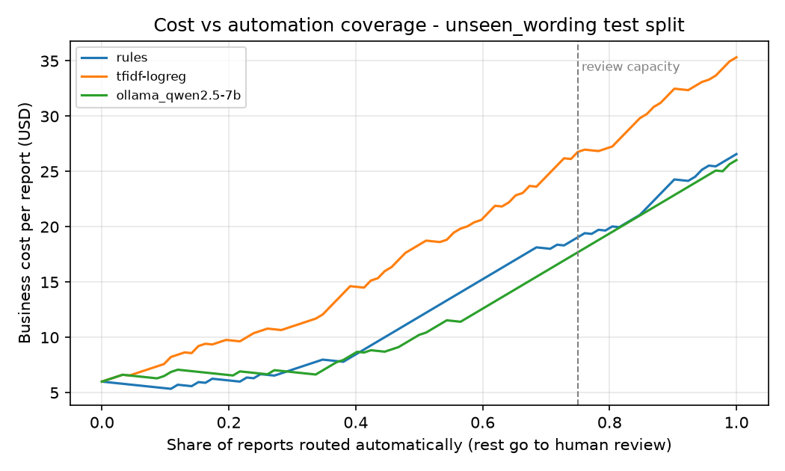
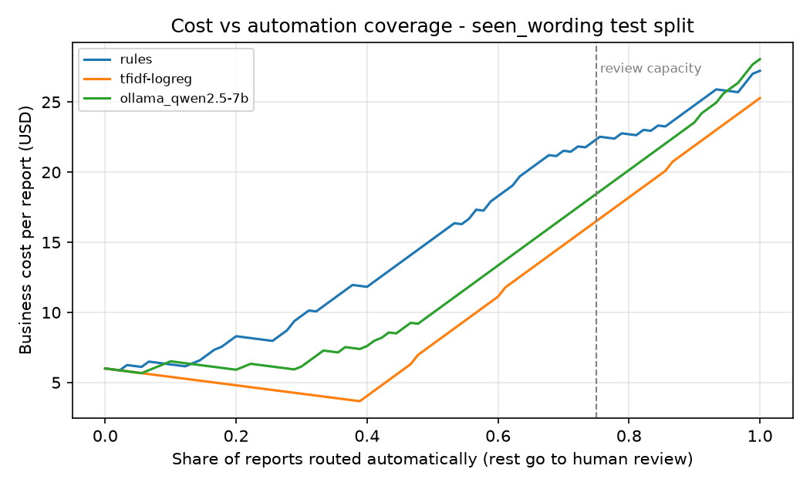

# Evaluation report

Generated by `scripts/evaluate.py` - do not edit by hand.

Cost model (USD per report): `{'missed_urgent': 500.0, 'false_urgent': 40.0, 'wrong_queue': 25.0, 'human_review': 6.0, 'correct': 0.0, 'extra': {}}`. Human review capacity: 25% of volume.

- `(argmax)` / `(no abstain)`: every report is auto-routed on the model's top prediction.
- `+ policy`: cost-aware routing (`triage/policy.py`). Urgency probability is calibrated on the val split; reports are sent to human review where that saves the most expected cost, up to the review capacity.
- `hybrid`: TF-IDF handles reports it is confident about; the rest go to the LLM.
- `business_cost_per_report` counts misroutes and reviews only; `total_cost_per_1k` adds LLM API cost.

## Scenario: unseen_wording (test n=92, urgent=39)

TF-IDF configuration chosen on val: `{'features': 'word+char', 'C': 10.0}`

| approach | category_accuracy | category_macro_f1 | urgent_recall_all | abstain_rate | auto_fully_correct | missed_urgent_auto | false_urgent_auto | business_cost_per_report | compute_cost_per_1k | total_cost_per_1k | latency_p50_ms | latency_p95_ms | accuracy_easy | accuracy_hard |
|---|---|---|---|---|---|---|---|---|---|---|---|---|---|---|
| rules (no abstain) | 0.859 | 0.856 | 1.000 | 0.000 | 0.348 | 0.000 | 53.000 | 26.576 | 0.000 | 26576.087 | 0.022 | 0.027 | 0.909 | 0.600 |
| rules + policy | 0.859 | 0.856 | 1.000 | 0.000 | 0.348 | 0.000 | 53.000 | 26.576 | 0.000 | 26576.087 | 0.022 | 0.027 | 0.909 | 0.600 |
| tfidf-logreg (argmax) | 0.370 | 0.345 | 0.359 | 0.000 | 0.261 | 25.000 | 2.000 | 148.424 | 0.000 | 148423.913 | 0.969 | 1.058 | 0.377 | 0.333 |
| tfidf-logreg + policy | 0.370 | 0.345 | 0.821 | 0.304 | 0.250 | 0.000 | 22.000 | 22.804 | 0.000 | 22804.348 | 0.969 | 1.058 | 0.377 | 0.333 |
| ollama_qwen2.5-7b (argmax) | 0.880 | 0.877 | 0.744 | 0.000 | 0.750 | 10.000 | 6.000 | 58.859 | 0.000 | 58858.696 | 3040.614 | 3525.982 | 0.870 | 0.933 |
| ollama_qwen2.5-7b + policy | 0.880 | 0.877 | 0.744 | 0.185 | 0.813 | 1.000 | 6.000 | 11.054 | 0.000 | 11054.348 | 3040.614 | 3525.982 | 0.870 | 0.933 |
| hybrid: tfidf -> ollama_qwen2.5-7b | 0.630 | 0.619 | 0.949 | 0.065 | 0.570 | 0.000 | 14.000 | 15.446 | 0.000 | 15445.652 | 1.013 | 3310.781 | 0.623 | 0.667 |

### Auto-routed mistakes

**rules (no abstain)** - 60 auto-routed errors, 0 sent to review (full list: `results/errors/unseen_wording__rules_no_abstain.csv`)

| id | difficulty | true | predicted | report |
|---|---|---|---|---|
| INC-0001 | easy | damaged_goods/urgent | safety_incident/urgent | Driver report: Pallet collapsed at Gate 4 at Felixstowe and bottled drinks is spread across teh main yard road |
| INC-0002 | easy | damaged_goods/normal | damaged_goods/urgent | Email from customer: Forklift tines punctured 13 cartons of books in the racking. Stock quarantined for inspec |
| INC-0003 | easy | damaged_goods/urgent | safety_incident/urgent | WhatsApp from driver: Pallet collapsed at Bay 12 and bottled drinks is spread across the main yard road, truck |
| INC-0004 | easy | damaged_goods/urgent | safety_incident/urgent | Ticket via portal: pallet collapsed at dock 7 and paper rolls is spread across the main yard road, trucks can' |
| INC-0005 | easy | damaged_goods/normal | damaged_goods/urgent | Call log: Received SHP-72288 with 26 cartons crushed, books inside look ok but packaging is ruined. Photos att |
| INC-0006 | easy | damaged_goods/normal | damaged_goods/urgent | Email from customer: Received SHP-17881 with 32 cartons crushed, auto parts inside look ok but packaging is ru |
| INC-0007 | easy | damaged_goods/urgent | safety_incident/urgent | Shift lead: Pallet collapsed at teh Dublin yard and retail clothing is spread across the main yard road, truck |
| INC-0008 | easy | damaged_goods/urgent | safety_incident/urgent | Ops note - Pallet collapsed at Rotterdam DC and toys is spread across the main yard road, trucks can't get in  |

**rules + policy** - 60 auto-routed errors, 0 sent to review (full list: `results/errors/unseen_wording__rules_plus_policy.csv`)

| id | difficulty | true | predicted | report |
|---|---|---|---|---|
| INC-0001 | easy | damaged_goods/urgent | safety_incident/urgent | Driver report: Pallet collapsed at Gate 4 at Felixstowe and bottled drinks is spread across teh main yard road |
| INC-0002 | easy | damaged_goods/normal | damaged_goods/urgent | Email from customer: Forklift tines punctured 13 cartons of books in the racking. Stock quarantined for inspec |
| INC-0003 | easy | damaged_goods/urgent | safety_incident/urgent | WhatsApp from driver: Pallet collapsed at Bay 12 and bottled drinks is spread across the main yard road, truck |
| INC-0004 | easy | damaged_goods/urgent | safety_incident/urgent | Ticket via portal: pallet collapsed at dock 7 and paper rolls is spread across the main yard road, trucks can' |
| INC-0005 | easy | damaged_goods/normal | damaged_goods/urgent | Call log: Received SHP-72288 with 26 cartons crushed, books inside look ok but packaging is ruined. Photos att |
| INC-0006 | easy | damaged_goods/normal | damaged_goods/urgent | Email from customer: Received SHP-17881 with 32 cartons crushed, auto parts inside look ok but packaging is ru |
| INC-0007 | easy | damaged_goods/urgent | safety_incident/urgent | Shift lead: Pallet collapsed at teh Dublin yard and retail clothing is spread across the main yard road, truck |
| INC-0008 | easy | damaged_goods/urgent | safety_incident/urgent | Ops note - Pallet collapsed at Rotterdam DC and toys is spread across the main yard road, trucks can't get in  |

**tfidf-logreg (argmax)** - 68 auto-routed errors, 0 sent to review (full list: `results/errors/unseen_wording__tfidf-logreg_argmax.csv`)

| id | difficulty | true | predicted | report |
|---|---|---|---|---|
| INC-0001 | easy | damaged_goods/urgent | lost_or_stolen/normal | Driver report: Pallet collapsed at Gate 4 at Felixstowe and bottled drinks is spread across teh main yard road |
| INC-0002 | easy | damaged_goods/normal | delivery_delay/normal | Email from customer: Forklift tines punctured 13 cartons of books in the racking. Stock quarantined for inspec |
| INC-0003 | easy | damaged_goods/urgent | lost_or_stolen/urgent | WhatsApp from driver: Pallet collapsed at Bay 12 and bottled drinks is spread across the main yard road, truck |
| INC-0004 | easy | damaged_goods/urgent | safety_incident/urgent | Ticket via portal: pallet collapsed at dock 7 and paper rolls is spread across the main yard road, trucks can' |
| INC-0005 | easy | damaged_goods/normal | safety_incident/normal | Call log: Received SHP-72288 with 26 cartons crushed, books inside look ok but packaging is ruined. Photos att |
| INC-0006 | easy | damaged_goods/normal | delivery_delay/normal | Email from customer: Received SHP-17881 with 32 cartons crushed, auto parts inside look ok but packaging is ru |
| INC-0007 | easy | damaged_goods/urgent | delivery_delay/normal | Shift lead: Pallet collapsed at teh Dublin yard and retail clothing is spread across the main yard road, truck |
| INC-0008 | easy | damaged_goods/urgent | lost_or_stolen/normal | Ops note - Pallet collapsed at Rotterdam DC and toys is spread across the main yard road, trucks can't get in  |

**tfidf-logreg + policy** - 48 auto-routed errors, 28 sent to review (full list: `results/errors/unseen_wording__tfidf-logreg_plus_policy.csv`)

| id | difficulty | true | predicted | report |
|---|---|---|---|---|
| INC-0001 | easy | damaged_goods/urgent | lost_or_stolen/urgent | Driver report: Pallet collapsed at Gate 4 at Felixstowe and bottled drinks is spread across teh main yard road |
| INC-0002 | easy | damaged_goods/normal | delivery_delay/urgent | Email from customer: Forklift tines punctured 13 cartons of books in the racking. Stock quarantined for inspec |
| INC-0003 | easy | damaged_goods/urgent | lost_or_stolen/urgent | WhatsApp from driver: Pallet collapsed at Bay 12 and bottled drinks is spread across the main yard road, truck |
| INC-0004 | easy | damaged_goods/urgent | safety_incident/urgent | Ticket via portal: pallet collapsed at dock 7 and paper rolls is spread across the main yard road, trucks can' |
| INC-0005 | easy | damaged_goods/normal | safety_incident/urgent | Call log: Received SHP-72288 with 26 cartons crushed, books inside look ok but packaging is ruined. Photos att |
| INC-0007 | easy | damaged_goods/urgent | delivery_delay/urgent | Shift lead: Pallet collapsed at teh Dublin yard and retail clothing is spread across the main yard road, truck |
| INC-0008 | easy | damaged_goods/urgent | lost_or_stolen/urgent | Ops note - Pallet collapsed at Rotterdam DC and toys is spread across the main yard road, trucks can't get in  |
| INC-0009 | easy | damaged_goods/urgent | lost_or_stolen/urgent | WhatsApp from driver: Pallet collapsed at Rotterdam DC and pallets of electronics is spread across teh main ya |

**ollama_qwen2.5-7b (argmax)** - 23 auto-routed errors, 0 sent to review (full list: `results/errors/unseen_wording__ollama_qwen2.5-7b_argmax.csv`)

| id | difficulty | true | predicted | report |
|---|---|---|---|---|
| INC-0001 | easy | damaged_goods/urgent | safety_incident/urgent | Driver report: Pallet collapsed at Gate 4 at Felixstowe and bottled drinks is spread across teh main yard road |
| INC-0003 | easy | damaged_goods/urgent | damaged_goods/normal | WhatsApp from driver: Pallet collapsed at Bay 12 and bottled drinks is spread across the main yard road, truck |
| INC-0004 | easy | damaged_goods/urgent | vehicle_equipment_failure/normal | Ticket via portal: pallet collapsed at dock 7 and paper rolls is spread across the main yard road, trucks can' |
| INC-0007 | easy | damaged_goods/urgent | damaged_goods/normal | Shift lead: Pallet collapsed at teh Dublin yard and retail clothing is spread across the main yard road, truck |
| INC-0008 | easy | damaged_goods/urgent | damaged_goods/normal | Ops note - Pallet collapsed at Rotterdam DC and toys is spread across the main yard road, trucks can't get in  |
| INC-0012 | easy | damaged_goods/urgent | delivery_delay/normal | Ticket via portal: Pallet collapsed at the M6 services near Stafford and paper rolls is spread across the main |
| INC-0024 | easy | delivery_delay/urgent | safety_incident/urgent | WhatsApp from driver: Trailer jack-knifed ahead, our truck carrying cut flowers is stuck and the cold pack onl |
| INC-0026 | easy | delivery_delay/urgent | safety_incident/urgent | Driver report: Trailer jack-knifed ahead, our truck carrying cut flowers is stuck and the cold pack only lasts |

**ollama_qwen2.5-7b + policy** - 14 auto-routed errors, 17 sent to review (full list: `results/errors/unseen_wording__ollama_qwen2.5-7b_plus_policy.csv`)

| id | difficulty | true | predicted | report |
|---|---|---|---|---|
| INC-0001 | easy | damaged_goods/urgent | safety_incident/urgent | Driver report: Pallet collapsed at Gate 4 at Felixstowe and bottled drinks is spread across teh main yard road |
| INC-0024 | easy | delivery_delay/urgent | safety_incident/urgent | WhatsApp from driver: Trailer jack-knifed ahead, our truck carrying cut flowers is stuck and the cold pack onl |
| INC-0026 | easy | delivery_delay/urgent | safety_incident/urgent | Driver report: Trailer jack-knifed ahead, our truck carrying cut flowers is stuck and the cold pack only lasts |
| INC-0045 | easy | lost_or_stolen/urgent | vehicle_equipment_failure/urgent | From the yard: GPS tracker on SHP-77866 (fresh fish) just went dark and the truck is off route by 30km. Driver |
| INC-0049 | hard | lost_or_stolen/normal | lost_or_stolen/urgent | Ticket via portal: Looks like 38 boxes of white goods were stolen from the yard over the weekend, found the fe |
| INC-0053 | easy | lost_or_stolen/urgent | safety_incident/urgent | Ops note - GPS tracker on SHP-56028 (insulin) just went dark and teh truck is off route by 30km. Driver not an |
| INC-0055 | easy | lost_or_stolen/urgent | vehicle_equipment_failure/urgent | Ticket via portal: GPS tracker on SHP-86843 (chilled dairy) just went dark and the truck is off route by 30km. |
| INC-0062 | easy | safety_incident/normal | safety_incident/urgent | Ops note - Near miss Monday: reversing truck came close to a pedestrian at the Dublin yard. No injury. Suggest |

**hybrid: tfidf -> ollama_qwen2.5-7b** - 37 auto-routed errors, 6 sent to review (full list: `results/errors/unseen_wording__hybrid_tfidf_to_ollama_qwen2.5-7b.csv`)

| id | difficulty | true | predicted | report |
|---|---|---|---|---|
| INC-0001 | easy | damaged_goods/urgent | lost_or_stolen/urgent | Driver report: Pallet collapsed at Gate 4 at Felixstowe and bottled drinks is spread across teh main yard road |
| INC-0002 | easy | damaged_goods/normal | delivery_delay/urgent | Email from customer: Forklift tines punctured 13 cartons of books in the racking. Stock quarantined for inspec |
| INC-0003 | easy | damaged_goods/urgent | lost_or_stolen/urgent | WhatsApp from driver: Pallet collapsed at Bay 12 and bottled drinks is spread across the main yard road, truck |
| INC-0004 | easy | damaged_goods/urgent | safety_incident/urgent | Ticket via portal: pallet collapsed at dock 7 and paper rolls is spread across the main yard road, trucks can' |
| INC-0008 | easy | damaged_goods/urgent | lost_or_stolen/urgent | Ops note - Pallet collapsed at Rotterdam DC and toys is spread across the main yard road, trucks can't get in  |
| INC-0009 | easy | damaged_goods/urgent | lost_or_stolen/urgent | WhatsApp from driver: Pallet collapsed at Rotterdam DC and pallets of electronics is spread across teh main ya |
| INC-0013 | easy | damaged_goods/normal | safety_incident/urgent | WhatsApp from driver: Received SHP-22303 with 4 cartons crushed, toys inside look ok but packaging is ruined.  |
| INC-0014 | easy | damaged_goods/normal | lost_or_stolen/urgent | Shift lead: Forklift tines punctured 28 cartons of bottled drinks in the racking. Stock quarantined for inspec |

## Scenario: seen_wording (test n=90, urgent=35)

TF-IDF configuration chosen on val: `{'features': 'word', 'C': 0.3}`

| approach | category_accuracy | category_macro_f1 | urgent_recall_all | abstain_rate | auto_fully_correct | missed_urgent_auto | false_urgent_auto | business_cost_per_report | compute_cost_per_1k | total_cost_per_1k | latency_p50_ms | latency_p95_ms | accuracy_easy | accuracy_hard |
|---|---|---|---|---|---|---|---|---|---|---|---|---|---|---|
| rules (no abstain) | 0.889 | 0.888 | 1.000 | 0.000 | 0.344 | 0.000 | 55.000 | 27.222 | 0.000 | 27222.222 | 0.023 | 0.029 | 0.900 | 0.850 |
| rules + policy | 0.889 | 0.888 | 0.886 | 0.067 | 0.333 | 0.000 | 53.000 | 25.900 | 0.000 | 25900.000 | 0.023 | 0.029 | 0.900 | 0.850 |
| tfidf-logreg (argmax) | 0.967 | 0.964 | 0.971 | 0.000 | 0.956 | 1.000 | 0.000 | 6.389 | 0.000 | 6388.889 | 0.377 | 0.409 | 0.957 | 1.000 |
| tfidf-logreg + policy | 0.967 | 0.964 | 1.000 | 0.156 | 0.947 | 0.000 | 4.000 | 2.989 | 0.000 | 2988.889 | 0.377 | 0.409 | 0.957 | 1.000 |
| ollama_qwen2.5-7b (argmax) | 0.856 | 0.844 | 0.829 | 0.000 | 0.778 | 6.000 | 3.000 | 37.722 | 0.000 | 37722.222 | 3096.108 | 9828.219 | 0.829 | 0.950 |
| ollama_qwen2.5-7b + policy | 0.856 | 0.844 | 0.829 | 0.167 | 0.813 | 0.000 | 3.000 | 5.389 | 0.000 | 5388.889 | 3096.108 | 9828.219 | 0.829 | 0.950 |
| hybrid: tfidf -> ollama_qwen2.5-7b | 0.967 | 0.965 | 0.971 | 0.111 | 0.925 | 0.000 | 3.000 | 2.833 | 0.000 | 2833.333 | 2841.179 | 3548.406 | 0.971 | 0.950 |

### Auto-routed mistakes

**rules (no abstain)** - 59 auto-routed errors, 0 sent to review (full list: `results/errors/seen_wording__rules_no_abstain.csv`)

| id | difficulty | true | predicted | report |
|---|---|---|---|---|
| INC-0003 | easy | damaged_goods/urgent | safety_incident/urgent | WhatsApp from driver: Pallet collapsed at Bay 12 and bottled drinks is spread across the main yard road, truck |
| INC-0005 | easy | damaged_goods/normal | damaged_goods/urgent | Call log: Received SHP-72288 with 26 cartons crushed, books inside look ok but packaging is ruined. Photos att |
| INC-0006 | easy | damaged_goods/normal | damaged_goods/urgent | Email from customer: Received SHP-17881 with 32 cartons crushed, auto parts inside look ok but packaging is ru |
| INC-0012 | easy | damaged_goods/urgent | safety_incident/urgent | Ticket via portal: Pallet collapsed at the M6 services near Stafford and paper rolls is spread across the main |
| INC-0015 | easy | delivery_delay/normal | delivery_delay/urgent | Shift lead: missed our unloading slot at antwerp terminal, rebooked for tomorrow morning. auto parts still on  |
| INC-0021 | easy | delivery_delay/normal | delivery_delay/urgent | From the yard: Missed our unloading slot at Dock 7, rebooked for tomorrow morning. retail clothing still on th |
| INC-0027 | easy | delivery_delay/normal | delivery_delay/urgent | Ops note - Missed our unloading slot at the Dublin yard, rebooked for tomorrow morning. paper rolls still on t |
| INC-0030 | easy | documentation_customs/normal | documentation_customs/urgent | Call log: Certificate of origin not attached, preferential duty can't be claimed. |

**rules + policy** - 56 auto-routed errors, 6 sent to review (full list: `results/errors/seen_wording__rules_plus_policy.csv`)

| id | difficulty | true | predicted | report |
|---|---|---|---|---|
| INC-0003 | easy | damaged_goods/urgent | safety_incident/urgent | WhatsApp from driver: Pallet collapsed at Bay 12 and bottled drinks is spread across the main yard road, truck |
| INC-0005 | easy | damaged_goods/normal | damaged_goods/urgent | Call log: Received SHP-72288 with 26 cartons crushed, books inside look ok but packaging is ruined. Photos att |
| INC-0006 | easy | damaged_goods/normal | damaged_goods/urgent | Email from customer: Received SHP-17881 with 32 cartons crushed, auto parts inside look ok but packaging is ru |
| INC-0012 | easy | damaged_goods/urgent | safety_incident/urgent | Ticket via portal: Pallet collapsed at the M6 services near Stafford and paper rolls is spread across the main |
| INC-0015 | easy | delivery_delay/normal | delivery_delay/urgent | Shift lead: missed our unloading slot at antwerp terminal, rebooked for tomorrow morning. auto parts still on  |
| INC-0021 | easy | delivery_delay/normal | delivery_delay/urgent | From the yard: Missed our unloading slot at Dock 7, rebooked for tomorrow morning. retail clothing still on th |
| INC-0027 | easy | delivery_delay/normal | delivery_delay/urgent | Ops note - Missed our unloading slot at the Dublin yard, rebooked for tomorrow morning. paper rolls still on t |
| INC-0030 | easy | documentation_customs/normal | documentation_customs/urgent | Call log: Certificate of origin not attached, preferential duty can't be claimed. |

**tfidf-logreg (argmax)** - 4 auto-routed errors, 0 sent to review (full list: `results/errors/seen_wording__tfidf-logreg_argmax.csv`)

| id | difficulty | true | predicted | report |
|---|---|---|---|---|
| INC-0015 | easy | delivery_delay/normal | lost_or_stolen/normal | Shift lead: missed our unloading slot at antwerp terminal, rebooked for tomorrow morning. auto parts still on  |
| INC-0021 | easy | delivery_delay/normal | damaged_goods/normal | From the yard: Missed our unloading slot at Dock 7, rebooked for tomorrow morning. retail clothing still on th |
| INC-0027 | easy | delivery_delay/normal | vehicle_equipment_failure/normal | Ops note - Missed our unloading slot at the Dublin yard, rebooked for tomorrow morning. paper rolls still on t |
| INC-0157 | easy | delivery_delay/urgent | delivery_delay/normal | blood samples for Umbrella Pharma stuck in traffic, delivery window closes in 30 minutes and the hospital has  |

**tfidf-logreg + policy** - 4 auto-routed errors, 14 sent to review (full list: `results/errors/seen_wording__tfidf-logreg_plus_policy.csv`)

| id | difficulty | true | predicted | report |
|---|---|---|---|---|
| INC-0021 | easy | delivery_delay/normal | damaged_goods/urgent | From the yard: Missed our unloading slot at Dock 7, rebooked for tomorrow morning. retail clothing still on th |
| INC-0129 | easy | delivery_delay/normal | delivery_delay/urgent | From the yard: Ferry cancelled, trailer with bottled drinks will cross on the next sailing. ETA slips by 2 hou |
| INC-0139 | easy | delivery_delay/normal | delivery_delay/urgent | Call log: Ferry cancelled, trailer with paper rolls will cross on the next sailing. ETA slips by 9 hours. |
| INC-0290 | easy | vehicle_equipment_failure/normal | vehicle_equipment_failure/urgent | From the yard: trailer TR-221 has a flat tyre at the M6 services near Stafford, recovery booked, load can wait |

**ollama_qwen2.5-7b (argmax)** - 20 auto-routed errors, 0 sent to review (full list: `results/errors/seen_wording__ollama_qwen2.5-7b_argmax.csv`)

| id | difficulty | true | predicted | report |
|---|---|---|---|---|
| INC-0003 | easy | damaged_goods/urgent | damaged_goods/normal | WhatsApp from driver: Pallet collapsed at Bay 12 and bottled drinks is spread across the main yard road, truck |
| INC-0012 | easy | damaged_goods/urgent | delivery_delay/normal | Ticket via portal: Pallet collapsed at the M6 services near Stafford and paper rolls is spread across the main |
| INC-0051 | easy | lost_or_stolen/urgent | vehicle_equipment_failure/normal | From the yard: GPS tracker on SHP-75498 (cut flowers) just went dark and the truck is off route by 30km. Drive |
| INC-0065 | easy | safety_incident/normal | safety_incident/urgent | Ops note - Near miss Monday: reversing truck came close to a pedestrian at Dock 7. No injury. Suggest a banksm |
| INC-0074 | easy | safety_incident/normal | safety_incident/urgent | WhatsApp from driver: Near miss Monday: reversing truck came close to a pedestrian at Warehouse B. No injury.  |
| INC-0085 | easy | vehicle_equipment_failure/urgent | vehicle_equipment_failure/normal | WhatsApp from driver: Main sorter at Coventry DC has stopped completely during peak, 4000 parcels for same-day |
| INC-0087 | hard | vehicle_equipment_failure/normal | documentation_customs/normal | Call log: BROKEN AGAIN!!! the WMS label printer is a joke. Fix it properly this time!!! |
| INC-0125 | easy | damaged_goods/urgent | safety_incident/urgent | Ticket via portal: Crate of glass fell off the trailer onto lane 2 of the access road, road blocked, police as |

**ollama_qwen2.5-7b + policy** - 14 auto-routed errors, 15 sent to review (full list: `results/errors/seen_wording__ollama_qwen2.5-7b_plus_policy.csv`)

| id | difficulty | true | predicted | report |
|---|---|---|---|---|
| INC-0065 | easy | safety_incident/normal | safety_incident/urgent | Ops note - Near miss Monday: reversing truck came close to a pedestrian at Dock 7. No injury. Suggest a banksm |
| INC-0074 | easy | safety_incident/normal | safety_incident/urgent | WhatsApp from driver: Near miss Monday: reversing truck came close to a pedestrian at Warehouse B. No injury.  |
| INC-0087 | hard | vehicle_equipment_failure/normal | documentation_customs/normal | Call log: BROKEN AGAIN!!! the WMS label printer is a joke. Fix it properly this time!!! |
| INC-0125 | easy | damaged_goods/urgent | safety_incident/urgent | Ticket via portal: Crate of glass fell off the trailer onto lane 2 of the access road, road blocked, police as |
| INC-0166 | easy | documentation_customs/urgent | safety_incident/urgent | From the yard: Driver at Coventry DC without ADR documents for aerosol cans, police have stopped the truck on  |
| INC-0208 | easy | lost_or_stolen/urgent | safety_incident/urgent | WhatsApp from driver: Break-in at Warehouse B happening, alarm going off and two people seen loading bottled d |
| INC-0215 | easy | lost_or_stolen/urgent | safety_incident/urgent | From the yard: Break-in at Warehouse B happening, alarm going off and two people seen loading books into a van |
| INC-0252 | easy | safety_incident/normal | safety_incident/urgent | Driver report: Fire extinguisher at Bay 12 expired last month, needs replacing. |

**hybrid: tfidf -> ollama_qwen2.5-7b** - 6 auto-routed errors, 10 sent to review (full list: `results/errors/seen_wording__hybrid_tfidf_to_ollama_qwen2.5-7b.csv`)

| id | difficulty | true | predicted | report |
|---|---|---|---|---|
| INC-0065 | easy | safety_incident/normal | safety_incident/urgent | Ops note - Near miss Monday: reversing truck came close to a pedestrian at Dock 7. No injury. Suggest a banksm |
| INC-0074 | easy | safety_incident/normal | safety_incident/urgent | WhatsApp from driver: Near miss Monday: reversing truck came close to a pedestrian at Warehouse B. No injury.  |
| INC-0087 | hard | vehicle_equipment_failure/normal | documentation_customs/normal | Call log: BROKEN AGAIN!!! the WMS label printer is a joke. Fix it properly this time!!! |
| INC-0252 | easy | safety_incident/normal | safety_incident/urgent | Driver report: Fire extinguisher at Bay 12 expired last month, needs replacing. |
| INC-0268 | easy | safety_incident/normal | vehicle_equipment_failure/normal | WhatsApp from driver: Toolbox talk follow-up: hi-vis compliance was poor on night shift last week. |
| INC-0334 | easy | lost_or_stolen/urgent | safety_incident/urgent | Driver reports someone is cutting the curtain of trailer at Bay 12 right now, he is watching from the cab. Loa |
